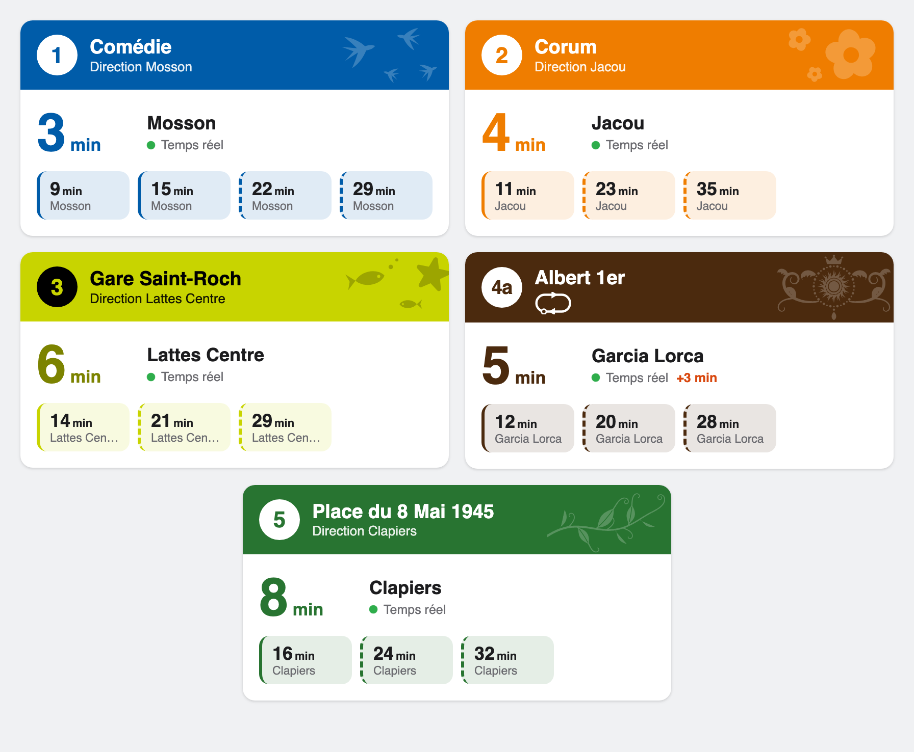

# TaM Montpellier pour Home Assistant


[](https://hacs.xyz/)
[](https://github.com/3615nulsi/ha-tam-montpellier/actions/workflows/validate.yml)
[](https://github.com/3615nulsi/ha-tam-montpellier/actions/workflows/tests.yml)

Dans combien de temps passe le prochain tram ? Cette intégration répond depuis
votre tableau de bord Home Assistant, pour les arrêts que vous choisissez, en
temps réel. Elle utilise l'[open data de la TaM](https://data.montpellier3m.fr/dataset/offre-de-transport-tam-en-temps-reel)
et fournit une carte qui reprend le style des afficheurs de quai.



> *In English: real-time departures for the Montpellier tramway (TaM, France),
> with a platform-display card. The docs are in French, like its users.*

## Installation

L'intégration est dans le catalogue de HACS, sans dépôt personnalisé à
ajouter. En un clic :

[](https://my.home-assistant.io/redirect/hacs_repository/?owner=3615nulsi&repository=ha-tam-montpellier&category=integration)

Ou cherchez **TaM Montpellier** dans HACS. Téléchargez-la, puis redémarrez
Home Assistant.

Sans HACS, copiez le dossier `custom_components/tam_montpellier` dans le
`custom_components` de votre configuration et redémarrez.

Home Assistant 2026.2 minimum (l'icône apparaît à partir de 2026.3).

## Ajouter vos arrêts

1. Ajoutez l'intégration :
   [](https://my.home-assistant.io/redirect/config_flow_start/?domain=tam_montpellier)
   Les réglages proposés conviennent, validez.
2. Sur la page de l'intégration, cliquez sur **Ajouter un arrêt**, puis
   choisissez la ligne, la direction et l'arrêt.

Recommencez pour chaque arrêt. Chacun devient un appareil, par exemple
« Comédie → Mosson (Tram 1) », avec ces capteurs :

- **Minutes avant le prochain passage** : c'est celui à regarder (voir plus bas pourquoi) ;
- **Prochain passage** et **Passage suivant** : les heures exactes ;
- **Destination du prochain passage** : pratique sur la ligne 3 (Lattes ou
  Pérols ?) ou quand un tram s'arrête avant le terminus ;
- **Perturbation** et **Message de perturbation** : s'allument quand une alerte
  TaM concerne la ligne, l'arrêt ou tout le réseau.

## La carte « afficheur de quai »

Elle est livrée avec l'intégration, rien d'autre à installer. Tableau de bord →
Modifier → **Ajouter une carte** → cherchez **« TaM – Afficheur de quai »** et
choisissez votre arrêt.

Vous y trouvez le compte à rebours, les trams suivants, le nombre de rames en
service et un bandeau quand il y a une perturbation, le tout aux couleurs de la
ligne.

Si elle affiche « Erreur de configuration », rechargez la page (dans
l'application mobile, tirez l'écran vers le bas).

<details>
<summary>En YAML</summary>

```yaml
type: custom:tam-board-card
device: <identifiant de l'appareil de l'arrêt>
name: Comédie        # facultatif
direction: Mosson    # facultatif
```

</details>

## Bon à savoir

**Les minutes sont arrondies à l'inférieur.** Si le capteur affiche « 2 min »,
il reste au moins 2 minutes : en partant maintenant, vous serez à l'heure. Le
« dans X minutes » que Home Assistant affiche pour un capteur d'heure arrondit
au plus proche et peut se tromper d'une minute et demie. Pour savoir quand
partir, fiez-vous au capteur minutes.

**La ligne 4 est coupée en deux.** Comme elle tourne en rond, chaque sens est
une ligne à part : **4a** (sens horaire) et **4b** (sens antihoraire).

**Pas de temps réel ? Pas de panique.** Si le flux temps réel ne répond plus,
les capteurs affichent les horaires théoriques au lieu de devenir
indisponibles.

**Les travaux sont pris en compte tout seuls.** Les horaires de travaux
arrivent avec les données publiées chaque nuit par la TaM. Si les trams partent
d'un autre quai du même arrêt, vous les voyez quand même.

**Mêmes horaires que M'Ticket, même un jour de perturbation.** Quand le
réseau est perturbé (manifestation, coupure de ligne), la TaM publie parfois
des courses de remplacement en plus des trams habituels. L'application
officielle M'Ticket ne les affiche pas, et l'intégration non plus par défaut.
Pour les voir quand même, cochez *Afficher les courses ajoutées par TaM* dans
*Configurer*, sur la page de l'intégration.

**Le bus aussi, si vous voulez.** Seul le tram est proposé au départ. Dans
*Configurer* sur la page de l'intégration, cochez les lignes de bus qui vous
intéressent (la 22, par exemple), puis ajoutez leurs arrêts comme pour le tram.
Ne cochez que celles dont vous avez besoin : chaque ligne prend de la mémoire
(environ 34 Mo pour le tram seul, 79 Mo avec tous les bus), ce qui compte sur
un Raspberry Pi.

**Rame courte ou rame longue.** Le capteur *Rame du prochain passage* donne
le modèle du tram attendu (Citadis 302, 401, 402 ou CAF Urbos), d'après son
numéro de parc. Les Citadis 302 font 32,5 m, les autres plus de 40 m. Quand la
TaM n'a pas encore attribué de rame à un passage, l'intégration reprend celle
de la course précédente du même service : elle est alors indiquée comme
*prévue*. Sur la carte, la mention « Rame courte » / « Rame longue » ne
s'affiche que sur les lignes où circulent des rames courtes (option
*Longueur de rame* de la carte).

**Les rames en service.** Chaque ligne de tram a aussi son appareil
(« Tram 1 », …) avec le nombre de rames qui circulent. Une rame qui patiente au
terminus peut disparaître un moment des données : elle reste comptée 20 minutes.

## Quelques idées

### Être prévenu quand il est temps de partir

Une notification quand le prochain tram passe dans moins de 9 minutes :

```yaml
triggers:
  - trigger: numeric_state
    entity_id: sensor.comedie_mosson_tram_1_minutes_avant_le_prochain_passage
    below: 9
actions:
  - action: notify.mobile_app_mon_telephone
    data:
      message: >
        Tram {{ state_attr(trigger.entity_id, 'line') }}
        dans {{ states(trigger.entity_id) }} min, c'est le moment de partir.
```

### Afficher les perturbations seulement quand il y en a

```yaml
type: conditional
conditions:
  - condition: state
    entity: binary_sensor.comedie_mosson_tram_1_perturbation
    state: "on"
card:
  type: markdown
  content: >
    ⚠️ {{ state_attr('sensor.comedie_mosson_tram_1_message_de_perturbation', 'full_message') }}
```

### Un tableau de départs fait maison

```yaml
type: markdown
content: >
  
  ### Tram {{ state_attr(s, 'line') }} · Comédie
  
  - **{{ d.minutes }} min** → {{ d.destination }}
     _(théorique)_
     · retard {{ d.delay }} min
  
```

## Pour les curieux

<details>
<summary>Les attributs des capteurs</summary>

Capteurs de passage :

- `line` (`4a` ou `4b` sur la ligne 4), `line_color`, `line_text_color`,
  `destination`, `delay` (en minutes) ;
- `clockwise` sur la ligne 4 ;
- `source`, la fiabilité de l'horaire :
  - `realtime` : annoncé par le temps réel pour cet arrêt,
  - `estimated` : tram pas encore parti du terminus, horaire théorique décalé
    du retard annoncé,
  - `scheduled` : horaire théorique seul ;
- `departures` (capteur minutes uniquement) : les 6 prochains passages, avec le
  même arrondi.

Capteurs de perturbation :

- `message` : le texte de la première alerte ;
- `full_message` : le texte complet (l'état est coupé à 255 caractères) ;
- `alerts` : toutes les alertes en cours, avec leur fin prévue et leur code TaM
  (`title`). Si le flux d'alertes décroche, les dernières connues restent.

Rames en service (`sensor.tram_1_rames_en_service`, …) :

- `running` : les rames visibles dans les données à l'instant ;
- `vehicles` : les numéros des rames comptées.

Pour les bus, les couleurs sont celles du GTFS de la TaM ; la carte ajuste
seulement la couleur du texte pour qu'il reste lisible.

</details>

<details>
<summary>Comment ça marche</summary>

- Le temps réel (GTFS-RT : trajets, positions des véhicules, alertes) est lu
  toutes les 30 secondes.
- Les horaires théoriques (GTFS, environ 8 Mo) sont téléchargés au démarrage
  puis chaque nuit à 3 h 30, et gardés en cache dans
  `.storage/tam_montpellier/` pour que les redémarrages soient rapides.
- La TaM ne publie le détail d'un trajet qu'une fois la rame partie du
  terminus. Pour un arrêt au milieu de la ligne, les passages plus lointains
  sont donc estimés à partir de l'horaire et du retard au départ.
- Un tram qui termine son trajet à votre arrêt n'est pas compté comme un
  départ, et les arrêts d'où aucun tram ne part ne sont pas proposés.
- Avec les journaux de débogage activés, chaque arrêt indique au chargement ses
  quais, son nombre de départs prévus et le prochain d'entre eux.

</details>

## Mettre les mains dedans

```bash
uv venv --python 3.13 .venv
uv pip install --python .venv/bin/python -r requirements_test.txt
.venv/bin/python -m pytest
```

Deux scripts utiles, sans Home Assistant :

```bash
.venv/bin/python scripts/live_board.py "Comédie" --line 1
```

affiche les départs en direct d'un arrêt, et

```bash
.venv/bin/python scripts/check_gtfs.py
```

vérifie que les données publiées par la TaM sont toujours bien comprises
(lignes, directions, arrêts, travaux en cours). GitHub Actions le lance chaque
matin pour repérer un changement avant qu'il ne gêne quelqu'un.

## Crédits et licence

L'icône rend hommage aux livrées des trams de Montpellier dessinées par
Garouste & Bonetti : les hirondelles de la ligne 1 et les fleurs de la ligne 2
([source](assets/icon.svg)).

Code sous licence [MIT](LICENSE). Projet indépendant, sans lien avec la TaM ni
avec Montpellier Méditerranée Métropole.

Données © TaM / Montpellier Méditerranée Métropole, sous licence
[ODbL](https://opendatacommons.org/licenses/odbl/).
